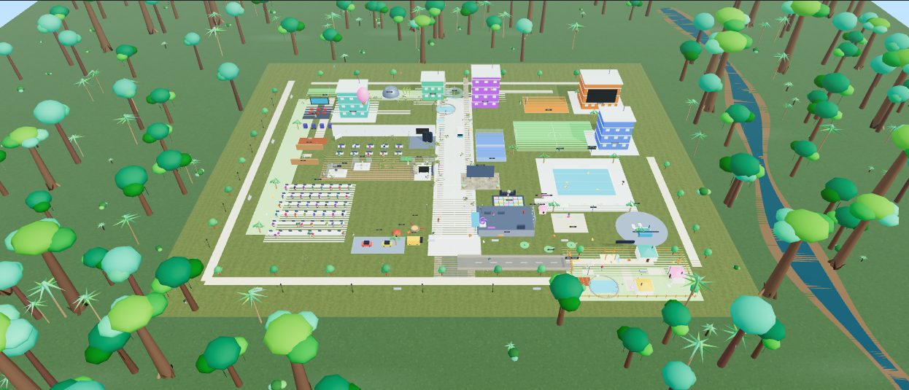
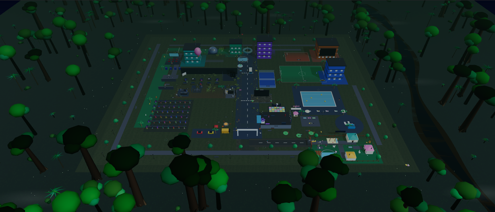

# OpenCode Virtual Office HQ - v5.4 (live AI campus: physics, collisions & Amazon jungle)

An **unofficial community project** — not affiliated with the OpenCode team.




3D office dashboard that streams **your real local OpenCode sessions**: titles,
directories, agents, models, token usage, status, live events, reasoning history,
diffs and files touched. No simulated scenarios, no placeholder sessions, models
or token counters.

The estate is an open-air live campus: a 10-desk workspace, glass rooms (lounge,
pantry, meeting, server), squad loft, pool, padel court, mini soccer pitch,
basketball court, tennis court, gym, cinema, arcade, library, pool bar, yoga deck,
helipad with helicopter, parking, mini golf, food truck, koi pond, observatory, a
floating hot-air balloon, a **Command Center**, a **live session board**, district
towers, roads with an animated shuttle, and an **Animal Village** - with **9 office
avatars per session** (1 lead + 8 squad members). Running sessions stay at their
desks; idle sessions are free to roam anywhere, including the sports wing.

v5.3 replaces the blocky placeholder people and furniture with external **CC0**
art: animated Quaternius characters, Poly Haven props, a Poly Haven HDRI
environment and tiled PBR ground materials. Everything still has a procedural
fallback, so the campus renders before the files arrive and when one is missing.

v5.4 makes the campus physically believable: every character walks a real
collision-aware route (A* + steering, sliding along walls, body separation),
the shuttle accelerates, brakes and yields to pedestrians, and the whole estate
is ringed by a dense, multi-species **Amazon rainforest** - emergent kapok
giants, Brazil-nut trunks, liana figs, acai palms, tree ferns, a black-water
river, drifting mist and fireflies - so the mansion reads as a remote clearing
in the jungle.

## Try it in 60 seconds (plug & play)

Requirements: **Node.js ≥ 20** and a running **OpenCode** instance on the same
machine (any version with the local server API — the bridge auto-discovers it).

```bash
git clone https://github.com/<you>/opencode-virtual-office-hq.git
cd opencode-virtual-office-hq
npm install
npm start
```

Open <http://localhost:5180> while OpenCode is running — your real sessions
appear as agents working in the campus. The bridge **auto-discovers** your local
OpenCode service; nothing else to configure. Options:

```bash
npm start -- --url http://127.0.0.1:4099   # skip discovery, point at a port
npm start -- --directory ~/code/my-app     # only show sessions of one project
npm start -- --port 4041                   # move the bridge WebSocket port
```

Want the realistic CC0 art (animated characters, Poly Haven props, HDRI, ~25 MB)?

```bash
npm run assets
```

Without it the campus still fully renders — every asset has a procedural
fallback, and the status chip reports what loaded.

### Privacy & safety

- The bridge binds to `127.0.0.1` only and **never leaves your machine** —
  no telemetry, no CDN, no accounts, nothing phone-home.
- The bridge is **read-only**: it never creates sessions or sends prompts.
- Secret-looking values (tokens, API keys) are redacted before anything reaches
  the browser.
- Session titles/directories are rendered locally from your own OpenCode data.

## Tech stack

| Layer   | Technology                                | Notes                                |
| ------- | ----------------------------------------- | ------------------------------------ |
| Build   | Vite 8 + TypeScript 7 (`strict`)          | hashed assets, source maps           |
| 3D      | Three.js r186 (npm) + OrbitControls       | no CDN, pinned versions              |
| Styling | Tailwind CSS v4 (`@tailwindcss/vite`)     | dashboard is always dark              |
| Icons   | Lucide (npm) — pre-inlined SVG            | no runtime loader, no icon flash     |
| Art     | Quaternius + Poly Haven CC0 assets        | packed GLBs, local files, fallback   |
| State   | Internal event bus + stores (no deps)     | sessions + bounded event log         |
| Bridge  | Node + `@opencode/client` + `ws`          | SSE events + request/response relay  |

## Quick start

```bash
npm install
npm run assets     # optional: download the CC0 art into public/assets/
npm start          # bridge + dashboard in one command → http://localhost:5180

npm run dev        # dashboard only (vite)
npm run bridge     # bridge only → ws://127.0.0.1:4040, auto-discovers OpenCode

npm run build      # typecheck + production build → dist/
npm run preview    # serve dist/ at http://localhost:5181
npm run verify:ui  # Playwright smoke test (installed Chrome, headless)
npm run verify:boot# splash / no-FOUC verification
npm run verify:interaction # hover, inspect, focus, agent-click check
npm run verify:physics# A* routes, wall/door blocking, live penetration watch
```

The CC0 binaries are not committed (they cost ~25 MB); `npm run assets`
downloads and packs them reproducibly, and `npm run assets -- --force` refreshes
everything. Everything works without them via procedural fallbacks.

Open http://localhost:5180 — the dashboard auto-connects to
`ws://127.0.0.1:4040`. If the bridge is off, the UI shows **Bridge Offline** and
empty states with the command to start it.

## Real data sources (no fixtures)

| UI | Source |
| -- | ------ |
| Session tabs, cards, selector | `session.list()` + `session.active()` (active + last 24 h, max 30) |
| Title / directory / agent | `SessionInfo.title`, `location.directory`, `SessionInfo.agent` |
| Model | `SessionInfo.model` → `provider/model` |
| Tokens / cost | `SessionInfo.tokens` and `.cost` (per session; header sums visible ones) |
| Status | `session.active()` (`running`) + `outcome` |
| Cards' last activity | live events + one-time seed from `session.context()` |
| Reasoning / answers | `session.context()` history (real assistant reasoning/text) + live `THOUGHT` events |
| Diffs | `session.diff()` (uncommitted patch); when empty, **files touched** from real `write`/`edit` tool calls in history |
| Event stream | native OpenCode events (tool, shell, reasoning, text, usage, lifecycle) |

Office avatars are only a visualization of sessions — a deterministic, distinct
persona is assigned per visible session (first 10). With more than 10 sessions the
cards/tabs continue to scale; avatars are reused for the extras.

## External CC0 art (v5.3)

All external art is **CC0 1.0 Universal** and served from `public/assets/`, never
from a CDN at runtime. Provenance is recorded in
[`public/assets/ATTRIBUTION.md`](public/assets/ATTRIBUTION.md).

| Asset | Source | Local form |
| --- | --- | --- |
| Casual Female / Casual Male | Quaternius Ultimate Animated Characters, via Cinevva | `characters/*.glb`, 17 clips each |
| Sofa, coffee table, armchair, shelf, coffee cart, calathea, fern, street lamp, cat statue | Poly Haven models | packed self-contained `props/*.glb` |
| Kloofendal 48d Partly Cloudy (Pure Sky) | Poly Haven HDRI | 1k HDR, PMREM environment map |
| Grass Ground, Wood Floor, Asphalt 02, Concrete Floor 02 | Poly Haven textures | 1k diffuse/normal/roughness JPG |

- Characters are cloned with `SkeletonUtils`; geometry and skeleton stay shared,
  while six material slots (skin, shirt, pants, belt, face, hair) are cloned and
  tinted per agent. Idle/Walk/Run clips are cross-faded, and working agents get a
  light typing pose.
- Props are cloned, normalized by width/height/depth and placed with their base at
  ground level. The live procedural TV screen and all live-data textures stay.
- The HDRI is used only as `scene.environment` (PMREM); the themed procedural sky
  remains the background. PBR ground materials replace the painted ground.
- `scripts/fetch-assets.mjs` downloads the original Poly Haven `.gltf` bundles and
  packs each one into a single GLB with `@gltf-transform/cli copy` (no Draco or
  Meshopt). Re-run it to refresh the files.
- If any file is missing or fails to decode, that prop/character/material keeps its
  procedural stand-in. The scene rebuilds once when loading finishes, and the chip
  next to the scene title reports `CC0 art: all loaded` or the number unavailable.

## Movement physics & collision (v5.4)

`src/lib/physics.ts` is a small 2D rigid-body layer for the ground plane:

- **Obstacle world** (`src/lib/scene.ts → registerCollisionGeometry`): rotated
  boxes for the office wall, glass rooms with their real door gaps, desks,
  squad-loft tables, espresso bar, meeting table, lounge/pantry props, server
  racks, pool water, gym equipment, district towers, the session board, ponds,
  village cottages and boulevard bollards (≈90 obstacles).
- **Occupancy grid** at 0.5 m, baked with the character radius, powers 8-way
  **A\*** with no corner cutting; a string-pull smoothing pass validates every
  shortcut against the exact boxes, so returned routes never graze walls.
- **Steering** (`stepBody`): accelerate/brake profile per leg, sub-stepped
  integration, and circle-vs-OBB `resolve` that slides bodies along walls
  instead of stopping them. Blocked characters repath after 0.65 s.
- **Separation** (`separateBodies`): soft body-to-body pushing every frame so
  characters queue at doors instead of standing inside each other; seated/working
  characters are immovable.
- **Gait sync**: the Walk clip's timeScale follows actual ground speed, so feet
  stop sliding when an agent slows down.
- **Shuttle**: proper accel/brake curve with stopping-distance easing, spinning
  wheels, nose pitch, a moving collision box, and it brakes for any character in
  its lane.
- Agents whose session starts running now **walk back to their desk** along a
  routed path instead of teleporting (teleport only remains as an unreachable
  fallback).

`npm run verify:physics` asserts routes through doors/around the pool and tracks
every live character for 14 s to prove nobody ends a frame inside an obstacle.

## Amazon rainforest surroundings (v5.4)

`src/lib/jungle.ts` rings the campus clearing with ≈470 procedurally placed,
instanced rainforest trees in six species — emergent kapok with buttress roots,
Brazil-nut giants, liana figs, açaí palms, tree ferns and understory bushes —
each merged into one vertex-coloured geometry and split into eight octants for
frustum culling. The belt also includes a winding black-water river with mud
banks, drifting ground mist, circling macaws and (in night mode) fireflies, plus
an exponential humus fog so the horizon dissolves into jungle. The forest is
100% decorative; no collision needed because characters are bounded to the
campus, and all data in the scene remains live.

## Bridge protocol

WebSocket JSON:

- **server → client**
  - `{ kind: 'hello', bridge, service }`
  - `{ kind: 'sessions', sessions: [...], totals, running, ts }` (on connect + every 3 s and after changes)
  - `{ kind: 'event', agent, type, tool?, message, session?, sessionTitle? }`
  - `{ kind: 'response', id, ok, data | error }`
- **client → server**
  - `{ kind: 'request', id, op: 'diff', sessionID }`
  - `{ kind: 'request', id, op: 'history', sessionID }` → `{ messages, files }`

Read-only by design: the bridge never creates sessions or sends prompts.

### Privacy & safety

- Binds to `127.0.0.1` by default; use `--host` only if you know why.
- All outgoing text (broadcast + console) passes a sanitizer: ANSI/control chars
  stripped and common credentials masked (`TOKEN=…`, `Authorization: Bearer …`,
  `sk-*`, `ghp_*`, `MLY|*`, URL passwords). Best-effort — treat the feed as sensitive.
- `--directory <dir>` limits the event stream to one project.

### Options

```bash
npm run bridge -- --port 4041
npm run bridge -- --host 0.0.0.0
npm run bridge -- --directory "D:\Path\To\Project"
npm run bridge -- --url http://127.0.0.1:28894
```

Health/status: `http://127.0.0.1:4040/health`.

## Live AI campus (v5.4)

- **Key objects are inspectable**: hover/click is reserved for what matters —
  session agents (leads + squad, clicking selects their real session), the ten
  workstations, and the four live screens (Command Center, Session Board,
  Server Status, Lounge TV/CI feed). The inspector card shows category, zone and
  a yellow box highlight with `Focus camera` / `Open view`. Everything else is
  deliberately silent: roads, lawn, furniture, sports facilities, attractions,
  animals, visitors, staff, towers and the jungle are decorative, so the whole
  3D scene never turns into a click-hunt (and hover raycasts stay cheap — only
  the interactive roots are tested, not every mesh).
- **Physically believable movement**: agents, squad members and visitors route
  around ~90 real obstacles (walls through their doors, desks, furniture, pool,
  ponds, towers), accelerate/brake, slide along walls, separate from each other
  and never walk through anything; the shuttle brakes for pedestrians. See
  "Movement physics & collision" above.
- **Remote jungle setting**: the estate is an isolated clearing surrounded by a
  dense, multi-species Amazon rainforest with a black-water river, mist, macaws,
  night fireflies and depth fog. See "Amazon rainforest surroundings" above.
- **Open-air 180 x 150 campus** with grass, mown lawns, perimeter promenades,
  bike-width paths, trees, flower islands, benches and street lamps. The old
  enclosed-room walls were removed so the whole estate reads as a campus skyline.
- **Realistic CC0 dressing**: every human is an animated Quaternius rig with a
  tinted outfit; the lounge/pantry use Poly Haven furniture, houseplants, a coffee
  cart, street lamps and a cat statue. Ground, office parquet, roads and plaza use
  tiled Poly Haven PBR materials, lit by a CC0 sky HDRI environment.
- **Command Center**: an orange district tower with a large live screen showing
  real session count, running/idle split, each session's model, tokens and cost,
  plus the latest real event stream and bridge connection state.
- **Live session board**: a physical board on a paved plaza, backed by a real
  CanvasTexture. Columns are `RUNNING`, `IDLE` and `FAILED`; cards show the real
  session title, model and token count. It repaints every second.
- **District towers**: Command Center, Engineering (teal), Research (purple),
  QA Lab (green) and Infrastructure (blue), each with lit windows, roof beacon,
  antenna, plaza and signage. Engineering/QA/Research sit north of the atrium;
  Infrastructure and Command Center sit on the east ridge.
- **Roads & mobility**: a main boulevard with sidewalks, zebra crossings,
  bollards, a branch road to the Animal Village, a shuttle shelter, and an
  animated **Campus Shuttle** that stops at the shelter, reverses at each end and
  drives both lanes.
- **Animal Village** (south-east): fenced district with three cottages, duck pond
  with lilies/reeds, playground with swing + slide, vegetable garden, cat tree,
  hay bales, trough, flower beds, string lights, gate and a large village sign.
- **31 animals**: cats, dogs, ducks (pool + village pond), rabbits, capybaras,
  pandas, turtle, plus **alpacas, goats and pigs**. They walk, hop, swim, wag
  tails, twitch ears and roam their own zones (one desk cat keeps its spot).
- **Campus life**: 4 visitor NPCs walk fixed routes around the entrance, village
  and promenade; **10 butterflies** flutter over the flower beds. These are
  decorative, not agent data.
- **Agents**: 9 avatars per session (1 lead + 8 squad; up to 6 sessions = 54).
  The lead works at the core desks; the squad sits in the **squad loft** at the
  matching bench row. Session cards show `squad 8`. Idle sessions leave their
  desks and visit the lounge, espresso bar, meeting room, whiteboard, pool, padel
  court, soccer pitch, basketball court, gym, cinema, arcade, library, pool bar,
  yoga deck or lawns. Running sessions return to work automatically.
- **Live monitor textures**: desk monitors and squad-loft monitors use the same
  real agent feed (sessions, events, tokens, cost, bridge status) repainted once
  per second.
- **Sports campus**: pool with loungers/umbrellas/palms, glass-walled padel court,
  striped mini-soccer pitch with goals and scoreboard, basketball half-court,
  tennis court, gym with climbing wall, yoga deck.
- **Extra attractions**: cinema, arcade, library, bowling lane, pool bar, helipad
  with helicopter, parking with cars, koi pond, observatory, mini golf, food truck,
  dance floor with DJ booth, fire pit, pet corner, ice-cream cart, aquarium ring,
  entrance arch, flags, sculpture and a floating hot-air balloon.
- **11 campus staff** at their posts plus the animals, visitors and shuttle.
- Glass rooms with doors + signage, 10 lead desks, 6 squad benches, plants,
  pendant lamps, TV lounge with animated CI feed.
- Session leads and squad members are clickable (the whole squad highlights).
  Squad coworkers are visual-only; the session data stays in the cards/tabs.
- Camera presets: Overview, Office, Dev Desk, Server, Pool, Padel, Soccer,
  Basketball, Cinema, Tennis, Gym, Command, Board, Village, Lounge, Coffee,
  Top-Down.
- Dashboard is **always dark**; the moon/sun button relights only the 3D estate
  (persisted in `hq-office-theme`).

## Loading behaviour (no FOUC)

- Branded splash with inline critical CSS; `#app` hidden until boot + first frame.
- Dashboard dark from the first paint (no theme flash).
- Icons are pre-inlined SVG (`npm run icons` after editing `data-lucide` placeholders).
- The 3D scene boots immediately with procedural stand-ins; external CC0 art loads
  asynchronously and triggers one rebuild when ready. A failed asset only affects
  its own stand-in, never the live OpenCode data.
- 7 s failsafe + `<noscript>` fallback.

## Known limits

- Multi-floor interiors, lifts, first-person walking and weather/day-night cycles
  are not implemented yet; the expanded campus is one continuous outdoor level.
- `session.diff()` reflects **uncommitted** changes; clean/committed work shows the
  real files-touched fallback instead of a patch.
- 3D shows at most **6 sessions × 9 avatars = 54**; extra sessions still appear in
  tabs/cards. Squad coworkers are visual-only (not listed individually).
- External art adds about **25 MB** to `public/assets/`. It is local-only and
  optional; characters are stylized low-poly CC0 rigs, not photoreal scans.
- The collision world is 2D on the ground plane: no jumping, slopes or vertical
  gameplay, and the rainforest is a visual ring outside the bounded walkable
  campus. The heavier jungle and 54 live rigs cost a little frame rate on
  software renderers.
- reasoning/answers come from session context (last messages) plus live events;
  OpenCode's event stream itself has no replay.
